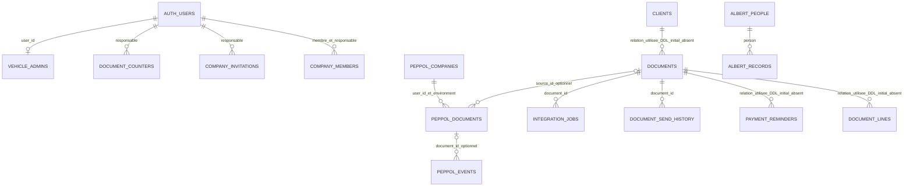

# Bases de données et stockage

[Sommaire](README.md) · [Dictionnaire SQL](dictionnaire-sql.md)

## Bases identifiées

Les fichiers [Facture/config.js](../../Facture/config.js), [Voitures/supabase-config.js](../../Voitures/supabase-config.js) et [albert_65ans/config.js](../../albert_65ans/config.js) référencent tous `https://dpwmxzptfgmkjecpuikb.supabase.co`. C'est un **projet Supabase configuré commun**, avec PostgreSQL, Auth, Data API/RPC, Edge Functions et Storage. Le partage effectif de chaque table distante n'a pas été introspecté. Nom administratif du projet, organisation, région, plan et version PostgreSQL distants : à confirmer. `project_id = "Facture"` dans config.toml est un identifiant local, pas le nom garanti du projet cloud.

Les navigateurs utilisent des clés publiques et des sessions utilisateur ; les fonctions serveur utilisent `SUPABASE_SERVICE_ROLE_KEY`. Aucune connexion SQL directe ni pool applicatif ne se trouve dans les frontends. Le pooler de la configuration **locale** est désactivé ; sa configuration cloud n'est pas connue.

## Domaines de données

| Périmètre | Tables / objets | Règle dans les sources |
|---|---|---|
| Facture historique | companies, clients, documents, document_lines, payment_reminders ; profiles mentionnée par l'ancien guide | DDL initial incomplet ; vérifier dans la base |
| Facture évolution | document_counters, document_send_history, integration_jobs, vat_purchases | SQL versionné, verrous et RPC |
| Équipe | company_members, company_invitations | Une appartenance active par membre ; responsable comme frontière de société |
| Peppol | peppol_companies, peppol_documents, peppol_events, peppol_webhook_events | Lecture par société, écriture serveur ; environnement dans les clés |
| Contact alternatif | orbytek_contact_requests, orbytek_contact_limits, orbytek_contact_events | Tables réservées au service_role, aucune lecture publique ; circuit non appelé par contact.js |
| Garage | voitures, vehicle_admins, vehicle_photo_cleanup | Catalogue public, écritures administrateurs autorisés |
| Famille | albert_private.settings, questions, people, records, characters | Schéma non exposé directement ; RPC public contrôlé par code ou mot de passe |

Les définitions et évolutions exactes disponibles figurent au [dictionnaire](dictionnaire-sql.md). Aucune vue SQL applicative `CREATE VIEW` n'a été repérée dans ces scripts. Les schémas internes `auth`, `storage`, `vault`, `cron` et `net` sont utilisés ou prévus ; ils ne doivent pas être confondus avec des bases distinctes.

## Relations

Les relations Facture signalées comme « DDL initial absent » sont des relations fonctionnelles attestées par le code ; existence, suppression en cascade et cardinalités SQL exactes doivent être confirmées. Les tables `albert_private.characters` sont indépendantes des participants, sans FK vers people. La file automobile référence des chemins, pas une FK vers `storage.objects`. Le rapprochement contact_events → requests se fait par `email_id` sans FK SQL déclarée.

## Sécurité et cohérence

**Facture :** la migration équipe remplace les politiques des tables métier par `user_id = active_company_owner()`, avec contrôle du client ou document parent. Le membre ne choisit pas librement un propriétaire dans le navigateur. `save_document_v2` valide les entrées, verrouille la société, numérote et sauvegarde document/lignes dans une transaction. La migration équipe adapte cette fonction par transformation de sa définition SQL : il faut vérifier la définition effectivement installée. Le README historique affirmant que la sauvegarde est non transactionnelle est dépassé par le code actuel.

**Peppol :** seules les lectures des tables métier du module sont accordées aux utilisateurs de la société. Écritures et webhooks passent par les fonctions serveur. Les triggers figent la facture et ses lignes dans les états engagés. Le bucket `peppol-archive` est privé ; les téléchargements passent par des URL signées de 60 secondes. Les journaux conservent événements et données de requête ; ils demandent une politique de conservation explicite.

**Voitures :** `vehicle_public_read` expose le catalogue à anon/authenticated. `is_vehicle_admin()` vérifie la liste SQL. Les chemins et dimensions des photos sont validés côté SQL. La policy Storage exige des chemins préenregistrés en file avant upload et empêche la suppression d'un fichier encore utilisé. L'addition d'autres policies permissives sur le même projet peut élargir ces droits : inventaire distant requis.

**Albert :** droits directs révoqués et RLS activé dans `albert_private`. Les RPC SECURITY DEFINER font les vérifications. Le code familial par défaut est publié dans le frontend : toute personne qui y a accès peut appeler les RPC familiaux. Les identités sont déclaratives ; l'isolation entre profils n'est pas une authentification individuelle. Un mot de passe administrateur fixe est présent en clair dans des sources existantes ; sa valeur n'est pas reproduite ici.

## Stockage hors tables

| Support | Données | Propriétés |
|---|---|---|
| Supabase Storage vehicle-photos | WebP galerie et miniature | Public ; ≤ 1 Mio par fichier, jusqu'à 10 photos par véhicule ; originaux non conservés |
| Supabase Storage peppol-archive | XML et PDF | Privé ; chemins par responsable/environnement/document |
| JSON/texte dans PostgreSQL | Logos et instantanés Facture, données et photos Albert | Les images ne passent pas toutes par Storage ; elles augmentent le poids des lectures/sauvegardes |
| IndexedDB Albert | Brouillons, versions et photos | Local par navigateur, synchronisation différée ; aucune garantie de sauvegarde sur un autre appareil avant synchronisation |
| localStorage | Préférences, favoris premium, rendez-vous de démo, chapitres vidéo, progression de liseuse | Peut être effacé par navigateur ; pas une base partagée |
| Fichiers statiques | Médias, HLS Archive, album chiffré | Copie des fichiers nécessaire ; pas une sauvegarde de PostgreSQL |
| Web3Forms / FormSubmit.io | Demandes de contact des sites raccordés | Conservation et accès fournisseur à confirmer ; pas de table Supabase alimentée par ces frontends |

## Migrations, initialisation, sauvegardes

Les migrations Facture sont des évolutions d'une base préexistante : elles ne suffisent pas à recréer toutes les tables historiques depuis zéro. Les commandes de reset ou db push ne sont donc pas présentées comme une restauration validée. `seed.sql` est référencé par config.toml mais aucun fichier correspondant n'a été trouvé sous `Facture/supabase`. Les noms de migrations Peppol ne sont pas une chronologie lexicographique fiable : respecter l'ordre explicite de [PEPPOL.md](../../Facture/PEPPOL.md).

Albert initialise 165 identifiants de questions et trois profils ; son seed privé historique est hors périmètre public. Voitures n'importe pas automatiquement de catalogue. La création et l'autorisation des administrateurs sont des étapes distinctes du setup.

Aucune politique distante de sauvegarde automatique, PITR, rétention, chiffrement de sauvegarde, test de restauration, RPO ou RTO n'a été vérifiée. Albert sait exporter une sauvegarde JSON complète depuis l'administration ; ce fichier contient des données et photos privées et doit être conservé hors des fichiers publiés. Les exports CSV TVA, PDF et fichiers JavaScript de chapitres ne remplacent pas une sauvegarde complète. Voir les [questions prioritaires](inconnues.md).
