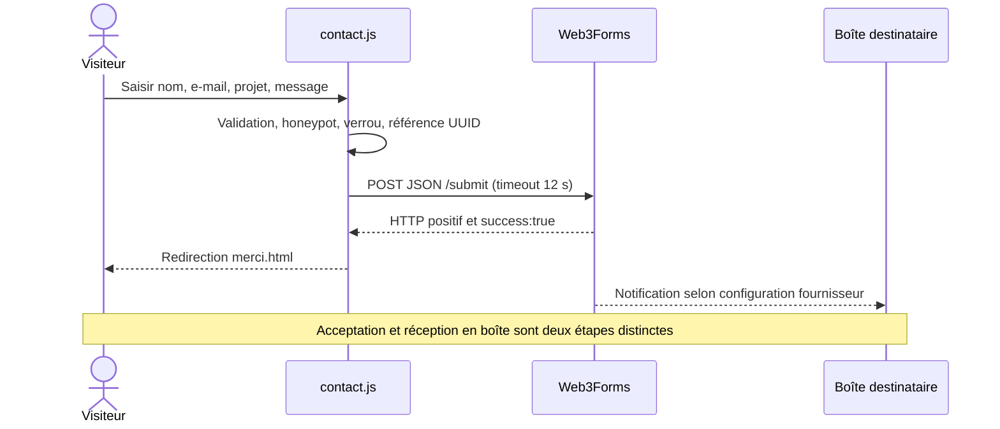
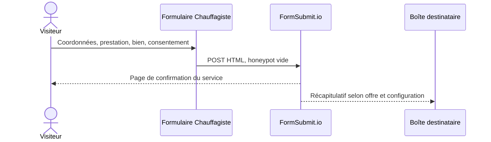
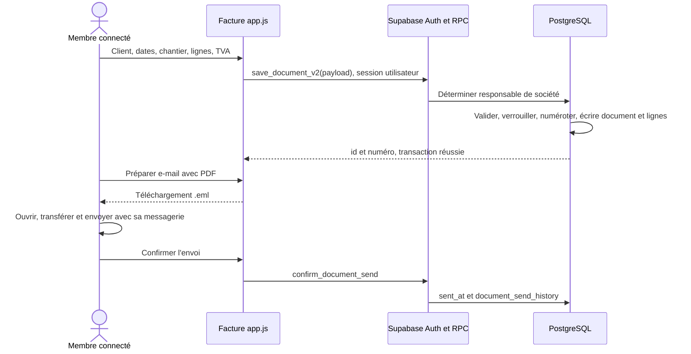
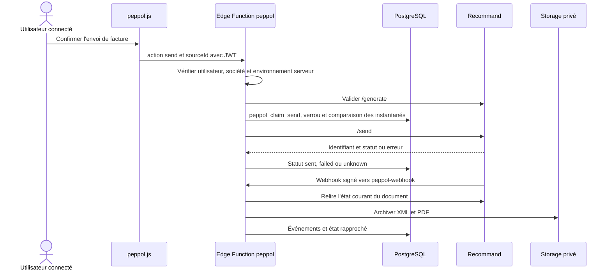
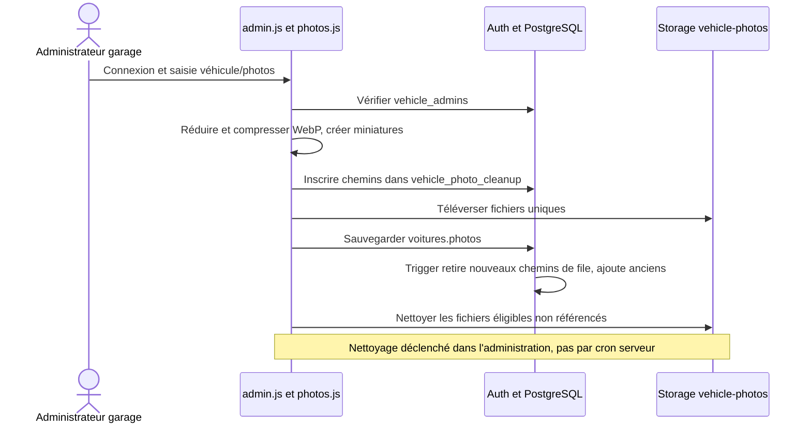
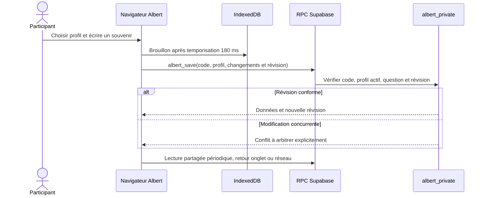
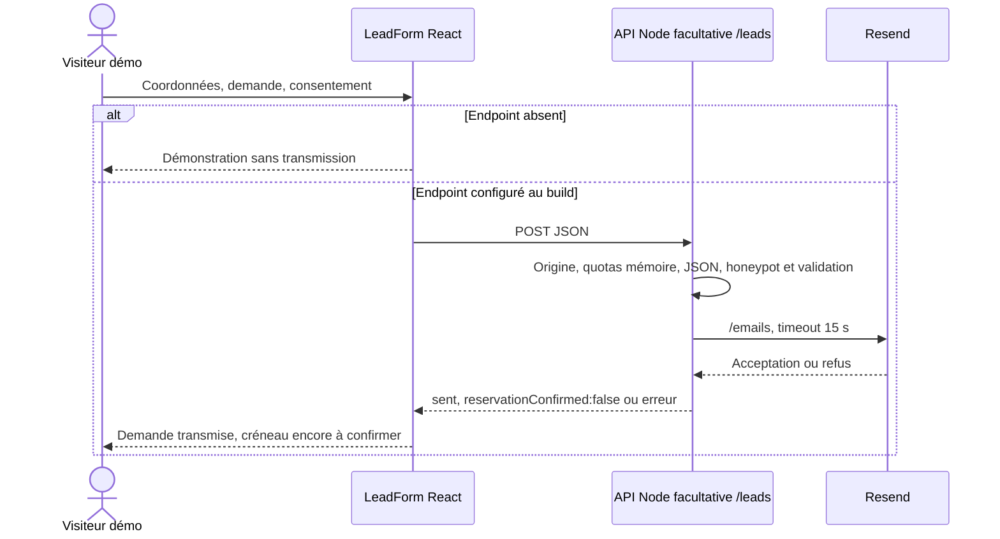
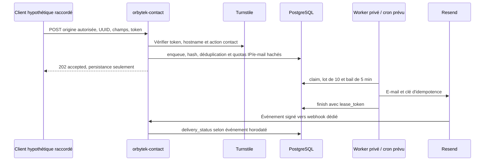

# Formulaires et flux métier

[Sommaire](README.md) · [Fiches applicatives](README.md#fiches-applicatives) · [Données](donnees.md)

## Recensement et destinations

| Application / parcours | Saisie et contrôle | Destination / effet réel dans le code |
|---|---|---|
| Contact Orbytek | name/email/message requis ; phone/company facultatifs ; project ; limites 120/254/80/160/5000 ; honeypot website | POST JSON Web3Forms, puis merci.html après confirmation ; aucune écriture Supabase par ce script |
| Chauffagiste devis | prenom, nom, tel, email, prestation, bien, message, consentement ; requis HTML et contrôles JS ; piège _formsubmit_id | POST HTML FormSubmit.io ; confirmation du prestataire ; pas de table locale |
| Facture inscription/connexion/récupération | E-mail, mot de passe ; nouveau mot de passe confirmé ; événements Supabase Auth | Auth signUp/signInWithPassword/resetPasswordForEmail/updateUser ; e-mails dépendants du projet Auth |
| Facture société/client/catalogue | Coordonnées, TVA, IBAN, logo, notes et prestations | companies, clients ; catalogues et apparence JSON ; logo redimensionné |
| Facture document | Client, type, dates, chantier, lignes quantité/prix/TVA, instantanés, récurrence | RPC save_document_v2 → documents, document_lines, document_counters |
| Facture envoi/relance | Destinataire, objet, message ; PDF généré | Fichier .eml local, envoi manuel ; confirmation → document_send_history ou payment_reminders |
| Facture équipe | Nom personnel, adresse invitée, lien accepté | RPC équipe ; token haché dans company_invitations ; lien communiqué manuellement |
| Facture TVA / paiement | Fournisseur, référence, dates, montants, déductibilité, catégorie ; payé / date de paiement | vat_purchases, documents ; export de préparation CSV ; aucune banque appelée |
| Facture Peppol | Activation, destinataire, envoi confirmé, avoir total, synchronisation, revue | Edge Function peppol → PostgreSQL, Recommand, Storage ; webhooks signés |
| AutoPrime admin | Connexion, véhicule, jusqu'à 10 photos | Auth + voitures + vehicle_photo_cleanup + Storage vehicle-photos |
| AutoPrime public | Estimation et contact | Confirmation simulée dans script.js ; pas de demande serveur |
| Albert | Profil ajouté/choisi, réponses, notes, accord/précision, conversations, anecdotes, jusqu'à 8 photos | IndexedDB puis RPC albert_* vers albert_private |
| Albert admin | Mot de passe, suppression/restauration, fiches personnages, export | RPC admin ; soft delete ; révision concurrente ; fichiers de sauvegarde privés |
| Liseuse | Mot de passe partagé ; numéro de page | Dérivation/déchiffrement locaux ; GET des .bin ; progression locale |
| Films / Archive | Import, édition, export de chapitres | localStorage et téléchargement JS ; aucune publication automatique |
| Premium immobilier | Recherche, favoris, comparaison, estimation, visite, contact | Filtres locaux ; LeadForm simule sans endpoint ou POST vers endpoint compilé |
| Premium restaurant | Réservation, panier, événement, cadeau, contact | Totaux locaux, pas de paiement ; LeadForm selon configuration ; créneau à confirmer |
| Premium paysagiste | Budget, projet en étapes, conseil/contact | Calculs locaux ; LeadForm selon configuration |
| La Laguna | Date/personnes/horaire, panier | Récapitulatif local puis lien Zenchef ; aucune commande envoyée par la maquette |
| Coiffeur | Réservation en étapes et newsletter | Modal / affichage simulés, pas d'API |
| Chauffagiste2 | Zone et demande | Recherche locale et affichage de succès, pas d'API |
| Chauffagiste3 | Demande | handleSubmit change le bouton, aucun envoi |
| Puériculture1 | Contact, panier et sélection | Affichage de succès et état local, pas de paiement ou API de commande |
| Rendezvous | Réservation, modification, recherche, annulation, réinitialisation | localStorage atelier-demo-v2 ; uniquement simulation |
| Puériculture2 | Aucun formulaire HTML analysable | Fichier index.html non HTML, voir fiche dédiée |

Les champs de détail et validations propres aux démonstrations sont inventoriés dans [inventaire.md](inventaire.md). Les fonctions de confirmation visuelle ne prouvent aucune transmission. Les protections serveur des services externes et leur conservation des données ne sont pas déductibles du JavaScript local.

## Contact Orbytek actif

Sources : [index.html](../../index.html), [contact.js](../../contact.js), [contact-config.js](../../contact-config.js), [CONTACT-SETUP.md](../../CONTACT-SETUP.md).

Le formulaire s'ouvre dans un dialogue. `enabled` et une clé publique suffisamment longue conditionnent sa disponibilité. La validation native `reportValidity()` précède le contrôle des champs obligatoires après trim. Le piège website interrompt le traitement. Un verrou `posting` empêche les doubles clics. Une référence UUID reste identique lors d'une nouvelle tentative avec les mêmes champs, mais aucun contrat de déduplication serveur n'est établi par ce code. Aucun fichier joint n'est prévu.

Une erreur HTTP, une réponse sans `success:true`, un JSON illisible ou un timeout conserve les champs et propose de réessayer. Le timeout ne démontre pas que le fournisseur n'a rien reçu. Le destinataire est lié à la clé du formulaire ; `replyto` reprend l'e-mail du visiteur. Le guide déclare une association à la boîte Orbytek et une création le 4 novembre, sans preuve actuelle de livraison en boîte.

## Devis Chauffagiste

Le navigateur réalise un POST natif vers l'action du formulaire. Les contrôles JS ne remplacent pas l'envoi ; l'action fonctionne aussi sans JS avec validation HTML. [FORMULAIRE.md](../../Chauffagiste/FORMULAIRE.md) rapporte une activation et un test HTTP 202 visibles chez le prestataire le 4 novembre ; cette rédaction ne les a pas reproduits. Les délais de récapitulatif mentionnés sont des constats historiques du guide, pas une garantie actuelle.

## Facture : création et partage d'un document

Sources : [app.js](../../Facture/app.js), [migration upgrade](../../Facture/supabase/migrations/20260926_upgrade.sql), [migration équipe](../../Facture/supabase/migrations/20261002_team.sql).

Les documents archivés conservent les coordonnées d'émetteur/client et l'apparence au moment de leur création. Le QR SEPA est construit localement ; il ne marque pas le paiement et n'appelle pas une banque. Les relances enregistrent préparation et confirmation déclarative. Le module Outlook/Graph existe et est chargé mais le parcours `sendDocument` consulté prépare actuellement un `.eml` ; `outlookClientId` n'est pas un identifiant configuré valide dans le fichier analysé. Ne pas présenter l'envoi Graph comme le circuit actif.

Pour une invitation, le responsable appelle `invite_company_employee`, reçoit un lien et le transmet lui-même. `join_company` vérifie l'e-mail confirmé, le hash du token, sa durée de sept jours et son usage unique. Le responsable peut retirer l'accès sans effacer les documents de la société.

## Peppol

Le circuit historique `invoice-integrations` génère/valide un XML de test ; il ne vaut pas transmission Peppol. Le nouveau module distingue playground et production d'après les secrets serveur. Un timeout devient état inconnu ; la synchronisation sert à rapprocher avant toute nouvelle tentative. Avoirs totaux uniquement ; revue et statut payé ne déclenchent pas de paiement ni de contestation au fournisseur.

## AutoPrime : photos et catalogue

Les visiteurs lisent par lots de 12, filtrent côté base puis ouvrent les grandes images à la demande. Les originaux de 25 Mo maximum sont traités dans le navigateur, pas conservés. Galerie 1600 px, miniatures 600 px, cible 400/100 Kio, limite finale 1 Mio. Si l'enregistrement échoue après upload, les fichiers abandonnés restent en file jusqu'à éligibilité et passage d'un administrateur.

## Questionnaire familial

Synchronisation annoncée toutes les 60 secondes dans le guide et gérée par app.js. Les photos sont réduites et intégrées aux données JSON ; huit par réponse/conversation maximum. Les exports complets doivent rester privés. La suppression admin d'un participant positionne `deleted_at`, masque ses contributions et bloque ses nouvelles écritures ; restauration possible. Les personnages ont leurs propres révisions et photos, indépendantes du questionnaire.

## Formulaires premium et API facultative

`LeadForm` dans [shared.tsx](../../premium-sites/components/shared.tsx) vérifie les créneaux futurs et les fermetures restaurant ; sans `NEXT_PUBLIC_REQUEST_ENDPOINT`, il explique qu'aucune donnée n'est transmise. Avec endpoint compilé, POST JSON et réussite seulement après HTTP valide. L'API fournie ne réserve aucun créneau et ne possède pas de table de réservation.

API : origine autorisée requise, types de demande prédéfinis, nom de 2–120 caractères, e-mail ≤254, consentement `on`, champs texte ≤5000, corps ≤16000 octets, dix demandes par dix minutes et adresse socket en mémoire. Sans clés ou adresses Resend, HTTP 503. Ce quota n'est pas partagé entre instances ; derrière un proxy, l'IP socket peut désigner le proxy. Aucun paiement, webhook bancaire ni émission effective de bon cadeau dans ces démos.

## Backend contact alternatif Supabase / Resend

Sources : [fonctions contact](../../Facture/supabase/functions/orbytek-contact/index.ts), [worker](../../Facture/supabase/functions/orbytek-contact-worker/index.ts), [SQL](../../Facture/supabase/migrations/20261104_orbytek_contact.sql), [cron](../../Facture/supabase/contact-cron.sql). **Le contact de la racine n'appelle pas ce circuit.**

Le serveur exige JSON ≤20000 octets, origine autorisée et secrets Turnstile/HMAC. Un doublon de même UUID et contenu est accepté sans nouvelle insertion ; un contenu différent produit un conflit. Le worker limite à huit tentatives et à une fenêtre de 23 heures, avec délai exponentiel plafonné à six heures. Le cron SQL propose un passage toutes les cinq minutes et une purge quotidienne des quotas ; son installation réelle n'est pas attestée. Le webhook vérifie signature Svix HMAC et tolérance de cinq minutes. Accepté, envoyé au fournisseur et livré sont trois états distincts.
