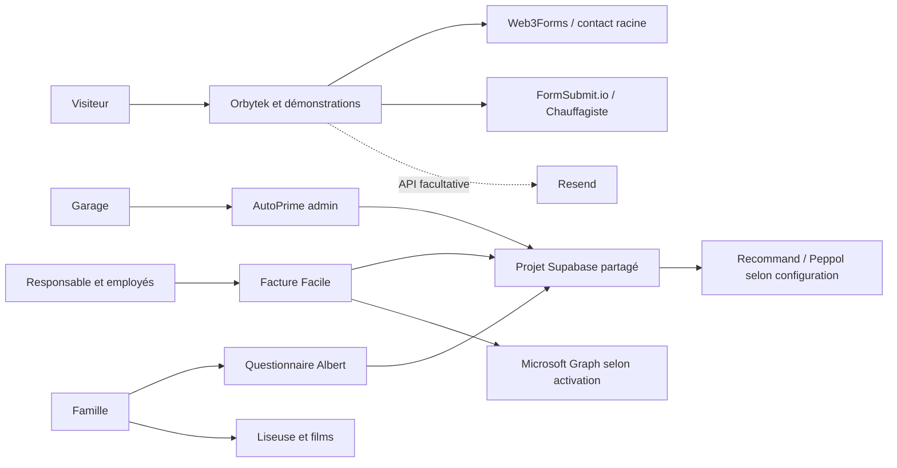
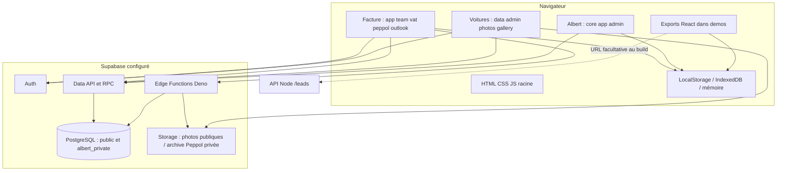
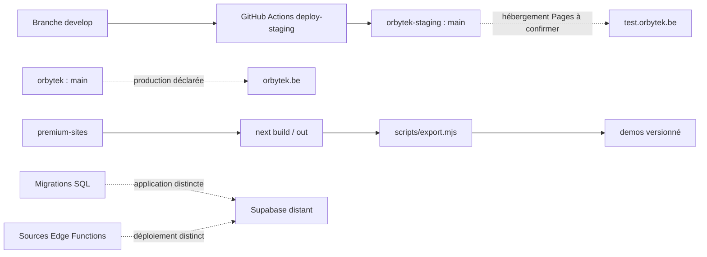

# Vue d'ensemble

[Sommaire](README.md) · [Inventaire](inventaire.md) · [Données](donnees.md)

## Finalité et utilisateurs

Le site commercial Orbytek présente les services de création web, applications, intégrations et support informatique. Son portfolio ouvre des démonstrations de métiers. Facture Facile gère les clients, devis, factures, relances, préparation TVA et échanges Peppol d'entreprises. AutoPrime expose un catalogue automobile administrable. Les applications Albert et les lecteurs de médias répondent à un besoin familial de collecte de souvenirs et de consultation d'une bande dessinée et d'un film.

Les visiteurs publics consultent les sites et saisissent des demandes. Les responsables et employés de Facture ont des sessions Supabase Auth et une appartenance à une société. Les administrateurs AutoPrime doivent appartenir à une liste SQL. Les participants Albert choisissent un profil partagé ; ce choix ne vaut pas authentification individuelle. La liseuse déchiffre des médias avec un mot de passe partagé. Les lecteurs vidéo ne disposent pas d'authentification applicative.

## Contexte

Sources : [contact.js](../../contact.js), [Chauffagiste/index.html](../../Chauffagiste/index.html), [Facture/app.js](../../Facture/app.js), [outlook-mail.js](../../Facture/outlook-mail.js), configurations Supabase des trois applications.

## Composants

Pas d'ORM serveur central repéré : les applications statiques utilisent le SDK Supabase, des requêtes Data API et des RPC PostgreSQL. L'API Node premium est indépendante du build Next statique. Aucun serveur Next n'est nécessaire pour servir `demos/`.

## Déploiement prévu par les sources

Le workflow de staging copie les fichiers, ne compile pas Next et n'applique pas les migrations. La liaison Pages de production à `main` n'est pas prouvée par ce seul workflow. Les rapports de publication Archive apportent un historique distinct, détaillé dans [Infrastructure](infrastructure.md).

## Technologies et versions lisibles

| Zone | Technologies / versions attestées dans les fichiers |
|---|---|
| Racine et applications classiques | HTML, CSS, JavaScript natif ; pas de manifeste racine |
| Premium | Next `^16.0.0`, React/React DOM `^19.2.0`, Framer Motion `^12.0.0`, Tailwind `^4.0.0`, TypeScript `^5.9.0` dans package.json ; versions verrouillées dans [inventaire](inventaire.md) |
| Supabase navigateur | Facture charge la majeure `@2` via CDN ; Voitures épingle `2.110.2` ; cela ne prouve pas une version serveur |
| Fonctions | Deno TypeScript ; contact importe supabase-js `2.49.8`, Peppol la majeure `2` |
| Base locale Supabase | PostgreSQL 17 et Deno 2 déclarés dans config.toml ; version distante à confirmer |
| Médias | Python, Pillow et FFmpeg pour préparation ; hls.js pour Archive ; Web Crypto pour la liseuse |
| PDF / identité Microsoft | html2pdf et qrcode locaux sous vendor ; MSAL local ; Microsoft Graph Mail.Send |

## Environnements et responsabilités

Local : serveurs statiques et modes simulés ; plusieurs configurations navigateur continuent de viser le Supabase distant. Développement : `premium-sites` peut utiliser Next sur le port 3000. Test : domaine `test.orbytek.be` prévu par CI. Production : domaine `orbytek.be` déclaré par CNAME et liens ; statut actuel dans les preuves publiques. Aucun environnement de base Supabase distinct pour staging n'a été identifié dans les trois configurations.

Les fichiers décrivent des mécanismes mais pas tous leurs propriétaires opérationnels. Registrar, comptes d'hébergement, région Supabase, facturation, renouvellements et personnes responsables restent à identifier dans [les inconnues](inconnues.md).

Les sondes publiques ont confirmé le service web GitHub et les DNS/MX OVH, ainsi que l'accès HTTPS aux domaines principal et test. Les réglages de publication internes restent inconnus. Certaines sources publiques diffèrent du commit local : voir [les preuves](preuves/README.md).
